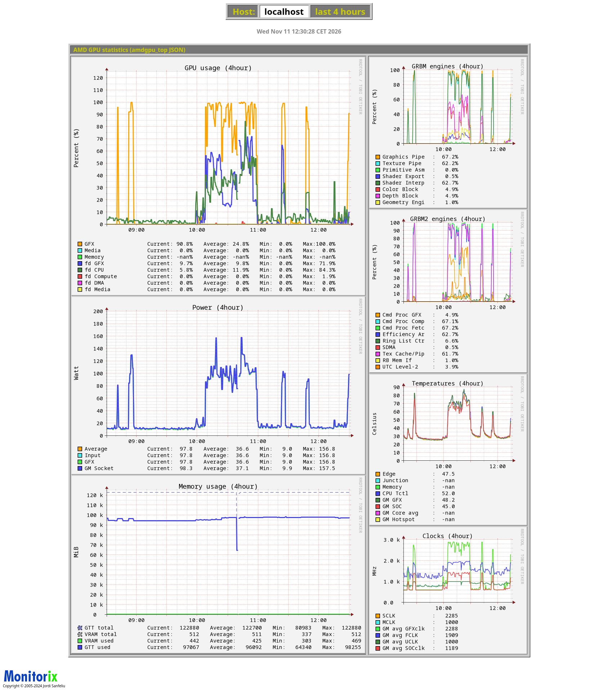
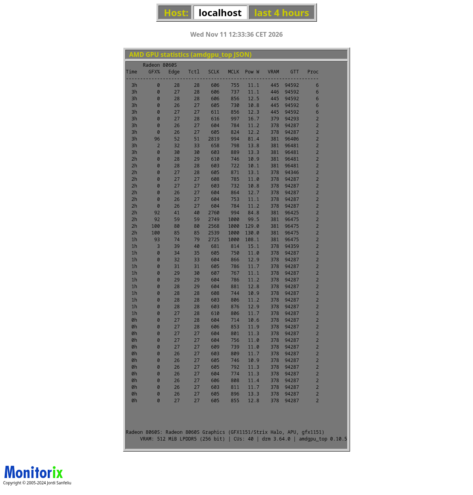

# Monitorix module `amdgpu_top`

A [Monitorix](https://monitorix.org) module that records the complete set of
numeric time series exposed by the JSON output of the
[`amdgpu_top`](https://github.com/Umio-Yasuno/amdgpu_top) tool
(`amdgpu_top -J -n 1`) — 79 data sources per device, with the few excluded
fields listed under “Deliberately not graphed” — and presents it in up to 10
graph panels (selectable via the `panels` option) or a value table + device
info block (text mode). Includes GRBM/GRBM2 engine utilization,
`gpu_metrics` telemetry and fdinfo usage data, none of which the built-in
`amdgpu` sysfs module offers.

Tested with Monitorix 3.16.0, Perl ≥ 5.36 (core modules only: `JSON::PP`, `RRDs`),
`amdgpu_top` v0.10.5 and a Radeon 8060S (gfx1151 / Strix Halo APU). Supports multiple
devices and groups (up to 8 devices per group).

| Graph view (last 4 hours) | Text view |
|---|---|
|  |  |

## Installation

```sh
# 1. module
sudo cp amdgpu_top.pm /usr/lib/monitorix/amdgpu_top.pm

# 2. configuration as drop-in (main config stays untouched)
sudo cp config/99-amdgpu_top.conf /etc/monitorix/conf.d/99-amdgpu_top.conf

# 3. restart the service (picks up conf.d and loads the module)
sudo systemctl restart monitorix
```

The module registers itself via the `graph_name` override in the drop-in and appears
in the WebUI menu. CGI URL:
`monitorix.cgi?mode=localhost&graph=amdgpu_top&when=day&color=white`.

Requirements: `amdgpu_top` in the daemon's `PATH` (or an absolute path in `cmd`); the
CGI process (user `nobody`) only needs the command for the optional info block
(`show_info`) — if it fails there silently, the text mode simply omits the block.

> German version of this document: [docs/README.de.md](docs/README.de.md)

## Configuration (drop-in, section `<amdgpu_top>`)

| Option | Default | Meaning |
|---|---|---|
| `<list>` | – | groups → device lists, indices into the JSON `devices[]`, e.g. `0 = 0` or `0 = 0, 1` for two devices in one group. |
| `cmd` | `amdgpu_top -J -n 1` | one-shot invocation (terminates by itself after ~1 s, no `timeout` wrapper needed). Absolute path possible. |
| `no_pc` | `n` | `y` → append `--no-pc` (GRBM/GRBM2 are then absent from the sources and appear as gaps/0). |
| `use_nan_for_missing_data` | `n` | `y` → missing sensor values as NaN (gap in graph); `n` → as 0. The shipped drop-in sets `y`. |
| `cmd_timeout` | `30` | Hard timeout (seconds) for each `amdgpu_top` invocation. Protects the Monitorix update loop against a wedged GPU/driver (the tool talks directly to DRM ioctls and could block indefinitely). |
| `panels` | all 10 | comma-separated list of visible panels (1-based). Disabled panels are hidden **in the WebUI only** — all 79 data sources keep being recorded in the RRD, so a panel can be re-enabled later without losing history. |
| `show_current_values` | `n` | short current-value legend in the small panels. The shipped drop-in sets `y`. |
| `show_info` | `n` | static device info block in text mode (best-effort via `amdgpu_top -J --dump`). The shipped drop-in sets `y`. |
| `file` | – | read JSON from a file instead of running the command (tests / dry-run only). |
| `<map>` | – | display name per device index, e.g. `0 = Radeon 8060S`. |
| `<desc>` | – | optional per-group description shown under the group's graphs. |
| `rigid` / `limit` | – | Monitorix standard (`y,u,l` per panel, axis bounds). |

Panel titles come from `<graphs>` (`_amdgpu_top1` … `_amdgpu_top10`), the module title
from `<graph_title>` — both already included in the drop-in.
Other global options set in the drop-in (`show_gaps`, `global_zoom`, `enable_zoom`,
`temperature_scale`, `rrdtool_extra_options`) work as usual.

## Panels

Left column (large, Current/Average/Min/Max legend):
**1. GPU usage (%) · 2. Power (W) · 3. Memory usage (MiB)**

Right column (small, short current-value legend with `show_current_values = y`):
**4. GRBM engines · 5. GRBM2 engines · 6. Temperatures (°C) · 7. Clocks (MHz) ·
8. Voltage (mV) · 9. Fan speed (%) · 10. Media engine usage (%)**

The memory panel shows the total sizes (VRAM/GTT total) as thin dashed reference
lines with the used values as solid lines on top.

The module balances both columns automatically: after drawing, the main-column graphs
are re-rendered so that both columns end at the same pixel height (no grey margins).

### Hiding permanently empty panels (`panels` option)

The shipped drop-in **disables panels 8–10** (`panels = 1, 2, 3, 4, 5, 6, 7`) because
they stay permanently empty on this gfx1151 APU (verified with 8 h of live data):

| Panel | Finding |
|---|---|
| 8 Voltage | `Sensors.{VDDGFX,VDDNB}` hardwired to 0; `gpu_metrics` voltages `null` |
| 9 Fan speed | `Sensors.Fan` and `gpu_metrics.fan_pwm` `null` (firmware-controlled) |
| 10 Media engine | fdinfo media engine counters `null`/constant 0 (no media workload counters) |

The data sources are still recorded unchanged. To re-enable a panel: add its number to
`panels` and uncomment the matching `_amdgpu_topN` title in the drop-in — the existing
history becomes visible immediately.

## Replacing the built-in `amdgpu` module

The drop-in fully supersedes the built-in `amdgpu` module:

- `<graph_enable> amdgpu = n` → the daemon stops collecting `amdgpu` data and the
  module disappears from the WebUI menu
- `graph_name = …` (full copy of the main-config list with `amdgpu` → `amdgpu_top`)
  → `amdgpu_top` appears **at exactly the old `amdgpu` position** in the menu and on
  the “all graphs” page

**Upgrade note:** the `graph_name` line in the drop-in copies the main config's default
list. After a Monitorix upgrade, re-compare it against `/etc/monitorix/monitorix.conf`
in case the default order changed. `additional_graph_name` and a `graph_name` override
must **not** be set at the same time (the conf.d merge order is not deterministic).

## RRD schema (79 data sources per device slot, prefix `e<group>d<slot>_`)

| Area | DS suffixes | Scaling |
|---|---|---|
| gpu_activity (3) | `act_gfx`, `act_media`, `act_mem` | – |
| GRBM (8) | `g_pipe`, `t_pipe`, `prim_asm`, `sh_export`, `sh_interp`, `color_blk`, `depth_blk`, `geom_eng` | – |
| GRBM2 (9) | `cp_gfx`, `cp_comp`, `cp_fetch`, `eff_arb`, `ring_ctrl`, `sdma`, `tex_cache`, `rb_memif`, `utc_l2` | – |
| Sensors Temp (10) | `t_edge`, `t_junc`, `t_mem`, `t_tctl`, `t_edg_crit`, `t_jnc_crit`, `t_mem_crit`, `t_edg_emer`, `t_jnc_emer`, `t_mem_emer` | – |
| Sensors Power (3) | `p_avg`, `p_input`, `p_gfx` | – |
| Sensors Clocks (2) | `sclk`, `mclk` | – |
| Sensors Voltage (2) | `vddgfx`, `vddnb` | – |
| Sensors Fan/PCIe (2) | `fan`, `pcie_lsp` | – |
| CPU frequencies (2) | `cpu_favg`, `cpu_fmax` | mean/max across cores |
| VRAM/GTT (4) | `vram_tot`, `vram_use`, `gtt_tot`, `gtt_use` | – |
| gpu_metrics (21) | `gm_t_*` (6 + core-mean `gm_t_core`), `gm_a*clk` (6), `gm_p_*` (4), `gm_v_*` (3), `gm_fan_pwm` | temperatures ÷100 → °C, power ÷1000 → W |
| fdinfo (13) | `fd_cpu`, `fd_comp`, `fd_dma`, `fd_dec`, `fd_enc`, `fd_gfx`, `fd_media`, `fd_jpeg`, `fd_vcn`, `fd_vpe`, `fd_vram`, `fd_gtt`, `proc_count` | `proc_count` = number of processes |

**Schema changes:** any change to the `@DSPEC` list in the module creates a new RRD —
the old one is automatically saved to `amdgpu_top.rrd.bak` and history starts from
scratch (convention of the other Monitorix modules). Temperature DS (`t_*`, `gm_t_*`)
are created with minimum `U` so genuinely negative readings are stored instead of
being silently discarded; all other DS use minimum `0`. (Existing RRDs created before
v1.3 can be migrated in place without data loss:
`rrdtool tune amdgpu_top.rrd --minimum <ds>:U` for each temperature DS.)

## Deliberately not graphed

- Static info fields (ASIC, VBIOS, CU count …) → text-mode info block only
- `PCI Power State`, `Power Profile` (strings, not measurements)
- `current_*` and `average_core_power` arrays of `gpu_metrics`
  (unit/aggregation undocumented; aggregation is deliberately defined for
  `cpu_favg/cpu_fmax` and `gm_t_core`, not for these)
- `gpu_metrics` VR temperatures (`temperature_vrgfx` / `temperature_vrmem` /
  `temperature_vrsoc`) and average voltages/currents (`average_*_voltage`,
  `average_*_current`) — not exposed by this driver/APU (always `null`) and
  unit documentation is sparse; add them to `@DSPEC` if your GPU reports them
- `gpu_metrics` `average_dclk1_frequency` / `average_vclk1_frequency` /
  `average_temperature_core` / `average_temperature_l3` (secondary memory
  channels and aggregate arrays; null on this APU)
- `gpu_metrics` `pcie_link_speed` / `pcie_link_width` (discrete link states,
  not a load curve) and `system_clock_counter` (raw monotonic counter)
- `Sensors` `"Fan Max"` (static limit) and `"Throttle Status"` (opaque bitmask)
- `xdna_fdinfo` (NPU utilization; separate future feature)
- Per-PID fdinfo details (dynamic PID list → only the aggregated `Total fdinfo` values
  plus `proc_count`)

Some recorded DS are intentionally not plotted in any panel (`fd_vram`,
`fd_gtt`, `pcie_lsp`, `cpu_favg/cpu_fmax`, `gm_t_l3`, `gm_p_cpu/gfx/soc`) —
they are available for custom graphs.

## DS naming note

RRD allows max. 19 characters per DS name; the suffixes are shortened accordingly and
match the GRBM2 JSON keys exactly (note: some contain **double spaces** in the
original). Always check new DS against `docs/plan.md` §2.2 and the `@DSPEC` list in
`amdgpu_top.pm`.

## Tests

```sh
./parse_test.pl    # parser against 3 JSON samples + live output
./t_robust.pl      # robustness: broken tool, edge cases, schema rotation
./t_update.pl      # update against RRD with exact-value checks (~3 min)
./t_cgi.pl         # CGI function: graph/text mode, day/week
```

Results are logged in `docs/testlog.md`. All harnesses load `amdgpu_top.pm` from the
repository (never the installed copy), so they always test the sources in this tree.

## Troubleshooting

- `ERROR ... timed out after 30 seconds (GPU or driver unresponsive?)` in the
  Monitorix log: `amdgpu_top` blocked in a DRM ioctl (e.g. during a GPU reset). The
  module killed it and wrote `U` values; raise `cmd_timeout` only if your system is
  legitimately slow to answer.
- `Can't exec "amdgpu_top"` on the daemon's stderr (visible in `journalctl -u
  monitorix`): the binary is not in the daemon's `PATH` — set an absolute path in
  `cmd`. Child stderr is passed through to the journal unfiltered.
- Panels show gaps: sensor fields intermittently return `null` on some kernels
  (e.g. `temperature_tctl` on gfx1151) — with `use_nan_for_missing_data = y` these
  appear as gaps, which is correct.

## File structure

```
amdgpu_top.pm                  # the Monitorix module (init/update/cgi, self-contained)
config/99-amdgpu_top.conf      # conf.d drop-in (install this!)
t_update.pl t_cgi.pl t_robust.pl parse_test.pl   # test harnesses
samples/                       # JSON samples (oneshot, nopc, dump)
docs/plan.md docs/environment.md docs/testlog.md # analysis/plan/test log (German)
docs/screenshots/              # README screenshots
```

## License

GPL-2.0-or-later (same as Monitorix itself). See [LICENSE](LICENSE).
